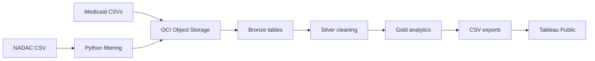
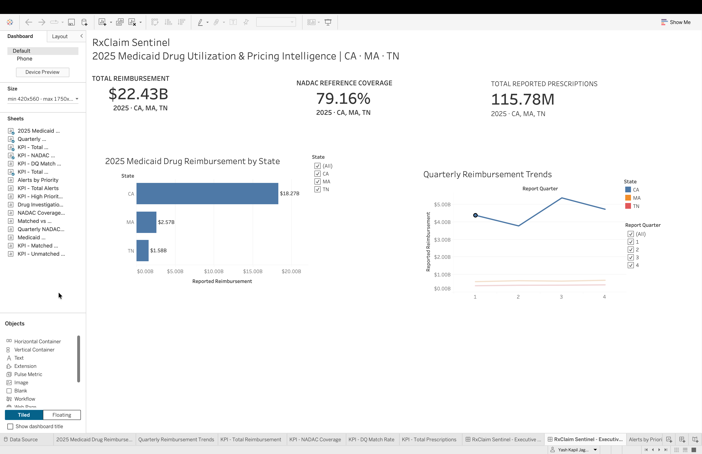
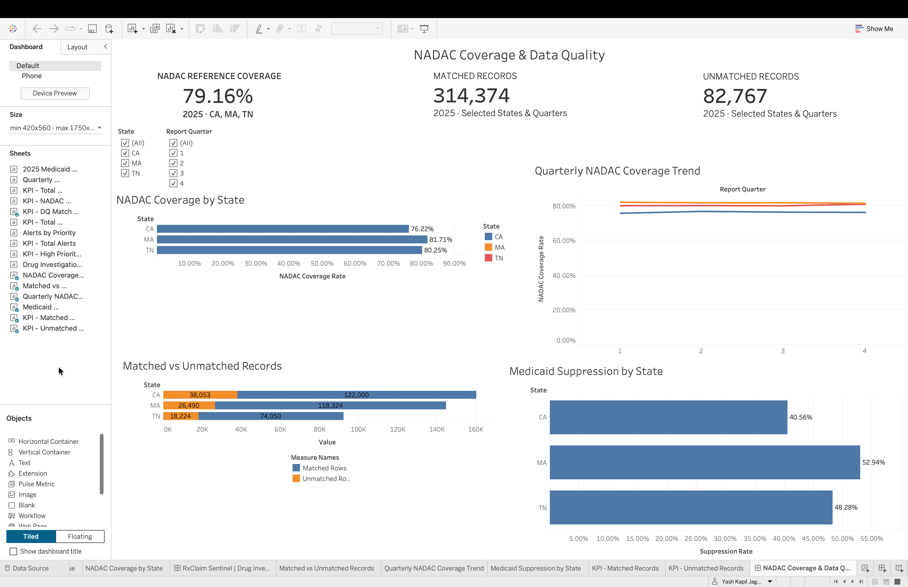
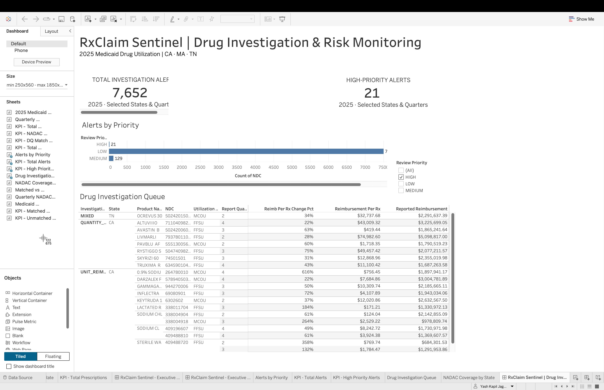

# RxClaim Sentinel

RxClaim Sentinel is a dashboard project that shows how Medicaid drug spending
changed across California, Massachusetts, and Tennessee in 2025, and which
drugs had reimbursement increases worth reviewing.

I downloaded public Medicaid drug utilization files, combined the three states'
data, and cleaned it in Oracle Cloud. I also used Python to filter national
average drug acquisition cost (NADAC) data to the drugs in the Medicaid dataset,
then added it to Oracle to see where pricing references were available.

Using SQL, I calculated spending and prescription trends and flagged drugs with
large increases in reimbursement per prescription. I exported the results to
Tableau and built three dashboards: an overall spending view, a pricing-reference
coverage view, and a prioritized drug investigation queue.

**Tools:** Python · OCI Object Storage · Oracle Autonomous Database · SQL · Tableau Public

## Data and results

- **397,141 Medicaid records** across California, Massachusetts, and Tennessee.
- **1,376,275 historical NADAC records** retained after Python filtering, split into 28 files.
- **4 Bronze tables and 13 SQL views** covering cleaning, quarterly metrics, NADAC coverage, and investigation rules.
- **7,652 records flagged for review** in the dashboard export.

The data contains aggregate utilization, not patient-level claims. Flags identify
records for investigation; they do not establish fraud or overpayment.

## How it works



I staged the source files in OCI Object Storage and loaded them into Oracle.
The Bronze layer holds the raw data, Silver cleans it, and Gold contains the
metrics used by the dashboards. SQL rules compare consecutive quarters and
assign review priorities to flagged records.

Loading and CSV exports are manual, and Tableau requires a manual data refresh.

## Dashboards

Open the [packaged Tableau workbook](dashboard/RxClaim_Sentinel_Executive_dashboard.twbx) for interactive exploration.

**Executive Overview** — spending, prescriptions, and quarterly trends.



**NADAC Coverage & Data Quality** — reference matching and suppression coverage.



**Drug Investigation & Risk Monitoring** — flagged NDCs and review priorities.



## Explore the project

- [Python scripts](src/) — NADAC filtering and API ingestion experiment.
- [Oracle SQL](sql/README.md) — Bronze, Silver, Gold, and setup order.
- [Tableau export queries](sql/exports/) — the three dashboard CSV interfaces.
- [Loading and export guide](docs/data_loading.md) — the workflow from source files to Tableau.
- [Technical notes](docs/dependency_map.md) — dependencies, analytical rules, and limitations.

## Validation

Run the offline tests with Python 3.9+:

```bash
python3 -B -m unittest discover -s tests -v
```

To check local Tableau CSVs against the workbook schema:

```bash
python3 -B scripts/validate_tableau_exports.py --data-dir data/processed/tableau
```

Source datasets and local CSV exports are excluded from Git. The packaged
workbook includes saved analytical extracts.
