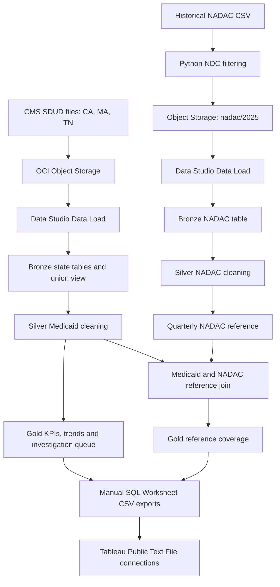

# RxClaim Sentinel

Medicaid drug spending analytics and anomaly investigation using Python,
Oracle Autonomous Database on OCI, and Tableau. Public state drug utilization
data flows through Bronze, Silver, and Gold layers to quarterly spending,
National Average Drug Acquisition Cost (NADAC) reference coverage, and
prioritized reimbursement-change investigations.

The data represents aggregate drug utilization, not patient-level claims.
Investigation alerts are screening indicators, not findings of fraud, pharmacy
profit, or confirmed overpayment.

## Architecture and current status



This batch analytics project includes **4 table definitions and 13 view
definitions**, exported from OCI on October 22, 2026. The supplied Oracle
inventory reported all 17 objects as `VALID`. Export completeness was verified
offline; the SQL has not been redeployed or the pipeline rerun during recovery.
The author-confirmed workflow stages files in OCI Object Storage and uses
Data Studio Data Load, manual SQL Worksheet CSV exports, and Tableau Public
Text File connections. See [loading and export instructions](docs/data_loading.md).
The supplied load totals are **397,141 Medicaid records** and **1,376,275
filtered NADAC records across 28 files**. A fresh-environment run has not been
verified during repository recovery.

Implemented artifacts include:

- Four Bronze source tables and a view combining Massachusetts, Tennessee, and California.
- Silver Medicaid/NADAC cleaning and ten Gold analytical views recovered from OCI.
- Quarterly NADAC reference selection, matching, and coverage summaries.
- Quarter-over-quarter investigation rules and high/medium/low review priorities.
- A Python NADAC API pagination experiment, limited to two 100-row pages.
- A Python historical NADAC filter that preserves matching source records and splits output files.
- A packaged Tableau workbook with three principal dashboards and an alternate executive layout.
- Oracle metadata inventory/export queries and an offline view-DDL import helper.
- Offline SQL-import tests and Tableau CSV compatibility checks.

There is no automated Oracle loader, pipeline orchestrator, ingestion ledger,
source-release monitor, or scheduler yet. Existing ingestion scripts use fixed
paths/settings and can replace prior outputs; inspect them before rerunning.

## Loading and refreshing

The full [loading guide](docs/data_loading.md) records Medicaid staging in
`rxclaim-raw-data`, Python filtering of the historical NADAC dataset, loading
from Object Storage, and the three confirmed Gold-to-CSV interfaces.
[Export SELECTs](sql/exports/) preserve the existing CSV column order. These
are documented projections from confirmed sources, rather than recovered SQL
Worksheet history. Updating Oracle views does not automatically update the
static CSVs or Tableau extracts.

## Analytical approach

Silver views trim identifiers, normalize selected text fields, and convert
numbers and dates with conversion errors becoming null. Medicaid measures are
populated only when the source suppression flag is `false`.

Gold views aggregate state/quarter/utilization spending and prescription counts,
then analyze individual NDC trends. The investigation queue requires consecutive
quarters, no suppressed source rows in either quarter, at least 30 prescriptions
in each, positive comparison metrics, and reimbursement-per-Rx growth of at
least 20% with a positive within-NDC effect. Priority is high at an effect of
at least $500,000 and medium at at least $100,000. These are screening rules;
their predictive accuracy has not been measured.

NADAC coverage is a separate branch. It selects the latest `AS_OF_DATE` within
each NDC/quarter in 2025, then joins by NDC/year/quarter. Pricing units and
effective dates are retained, but the SQL does not enforce an effective-date-as-of
join or reconcile Medicaid units with NADAC units. Equal latest dates have no
secondary tie-breaker. The investigation queue uses Medicaid trends rather than
a reimbursement-minus-NADAC calculation.

## Tableau deliverable

The authoritative deliverable is
[RxClaim_Sentinel_Executive_dashboard.twbx](dashboard/RxClaim_Sentinel_Executive_dashboard.twbx).
Open it in Tableau to view:

1. **RxClaim Sentinel - Executive Overview**
2. **NADAC Coverage & Data Quality**
3. **RxClaim Sentinel | Drug Investigation & Risk Monitoring**

The package also contains **RxClaim Sentinel - Executive Overview float**, an
alternate layout using the same executive worksheets. It contains saved extracts
and 16 worksheets. Repository checks inspect its XML definition; they do not
render the dashboards or validate the embedded extract contents.

The workbook references these CSV interfaces:

| Export | Purpose | Rows observed locally |
| --- | --- | ---: |
| `tableau_executive_overview.csv` | State/quarter spending and suppression summary | 24 |
| `tableau_nadac_coverage.csv` | Benchmark matching and coverage summary | 24 |
| `tableau_drug_investigations.csv` | Drug investigation queue | 7,652 |

These counts were measured from the local exports on October 22, 2026. They are
not assertions about a new cloud run or the freshness of packaged extracts.
External CSVs are excluded from Git. Updating CSV files does not automatically
refresh the packaged workbook's extracts.

## Offline verification

Python 3.9 or later is required. The current tools and tests use the standard
library and require no Oracle credentials or dependency installation.

```bash
python3 -B -m unittest discover -s tests -v
```

If the existing local analytical CSV exports are available:

```bash
python3 -B scripts/validate_tableau_exports.py --data-dir data/processed/tableau
```

This command checks CSV headers/order, row widths, numeric formats, finite
numeric values, 11-digit text NDCs, and the workbook's source-field types. It
prints a JSON report and exits nonzero on failure. A fresh clone does not include
the CSVs: missing files produce an explicit failure, while the unit suite runs
without them using temporary synthetic data.

The contract is recorded in [docs/tableau_export_contract.json](docs/tableau_export_contract.json).
These checks do not establish source grain, historical pricing alignment, unit
compatibility, metric reconciliation, or business-rule correctness. Blanks other
than NDC remain allowed; the CSV contract does not impose field nullability.

## Oracle implementation and recovery

See [SQL setup and dependency order](sql/README.md), the
[dependency map](docs/dependency_map.md), and the
[recovery manifest](docs/oracle_definition_manifest.json).
Oracle schema, storage settings, and ingestion annotations are preserved in the DDL.

For another full definition export, use
[the explicit 17-object query](docs/export_pipeline_definitions.sql).
[Recovery instructions](docs/BATCH_EXPORT_INSTRUCTIONS.md) explain the original
nine-view CSV workflow. Its legacy importer supports only those nine views;
it does not accept the complete 17-object TSV. That TSV was separately checked
for object targets, exact lengths, unique contiguous chunks, and part counts
before restoration. Existing SQL was preserved.

The supplied Oracle dependency export confirms all 17 relationships between
the recovered objects; the documented setup order respects each dependency.
See [the dependency manifest](docs/oracle_dependency_manifest.json). Loading
steps and source views are confirmed by the author. Exact historic query text,
database-to-dashboard reconciliation, and a fresh run remain unverified.

## Repository layout

| Location | Contents |
| --- | --- |
| `sql/bronze/` | Four source tables and the Medicaid consolidation view |
| `sql/silver/` | Medicaid and NADAC cleaning views |
| `sql/gold/` | Ten KPI, trend, investigation, reference, and coverage views |
| `sql/exports/` | Three documented Tableau CSV projections |
| `src/` | Existing NADAC ingestion/filter scripts |
| `scripts/` | Offline view restoration and Tableau compatibility checks |
| `tests/` | Synthetic offline verification |
| `docs/` | SQL inventory/export tools, recovery instructions, and contracts |
| `dashboard/` | Final packaged Tableau deliverable |

## Development and publication

The current portfolio baseline comprises Python preparation, OCI Object Storage
staging, Oracle medallion SQL, and the Tableau deliverable. The manual loading
and export workflow is documented. Database/file reconciliation and a fresh
Tableau refresh have not been independently verified during recovery.
Python orchestration, batch tracking, source-change detection, and scheduling
are future enhancements.

ELK validation logging and monitoring is a separate extension discussed by the
author; its implementation is not included in this repository baseline. It does
not automate the manual loading, CSV exports, or Tableau refresh.

Credentials, wallets, private connection files, and large generated source
files are excluded from Git. The packaged Tableau deliverable is an intentional
exception because it contains the saved analytical extracts needed for review.
