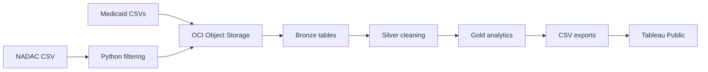

# RxClaim Sentinel

**Python · OCI Object Storage · Oracle Autonomous Database · SQL · Tableau Public**

I built RxClaim Sentinel to explore Medicaid drug spending, track reimbursement
changes, and prioritize drugs for further review. It combines public 2025
Medicaid utilization data with National Average Drug Acquisition Cost (NADAC)
reference data.

## Data and results

- **397,141 Medicaid records** across California, Massachusetts, and Tennessee.
- **1,376,275 historical NADAC records** retained after Python filtering, split into 28 files.
- **4 Bronze tables and 13 SQL views** covering cleaning, quarterly metrics, NADAC coverage, and investigation rules.
- **7,652 records flagged for review** in the dashboard export.

The data contains aggregate utilization, not patient-level claims. Flags identify
records for investigation; they do not establish fraud or overpayment.

## How it works



Files are loaded from Object Storage using Oracle Data Studio's Data Load tool.
SQL standardizes fields, handles suppressed values, builds quarterly NADAC
references, and calculates spending and reimbursement trends. Investigation
rules flag significant quarter-over-quarter increases and assign review priorities.

This is a manually orchestrated batch pipeline. Gold results are exported as
CSVs; Tableau requires a manual data refresh.

## Dashboards

Open the [packaged Tableau workbook](dashboard/RxClaim_Sentinel_Executive_dashboard.twbx) to explore:

- **Executive Overview** — spending, prescriptions, and quarterly trends.
- **NADAC Coverage & Data Quality** — reference matching and suppression coverage.
- **Drug Investigation & Risk Monitoring** — flagged NDCs and review priorities.

## Explore the project

- [Python scripts](src/) — NADAC filtering and API ingestion experiment.
- [Oracle SQL](sql/README.md) — Bronze, Silver, Gold, and setup order.
- [Tableau export queries](sql/exports/) — the three dashboard CSV interfaces.
- [Loading and export guide](docs/data_loading.md) — the workflow from source files to Tableau.
- [Technical notes](docs/dependency_map.md) — dependencies, analytical rules, and limitations.

## Validation

Run the offline tests with Python 3.9+:

```bash
python3 -B -m unittest discover -s tests -v
```

To check local Tableau CSVs against the workbook schema:

```bash
python3 -B scripts/validate_tableau_exports.py --data-dir data/processed/tableau
```

Source datasets and local CSV exports are excluded from Git. The packaged
workbook includes saved analytical extracts.
